# Assemblare Hamiltoniana Finale

## Punto di partenza

### Formula logica
Consideriamo una formula logica semplice:
- 3 variabili booleane
- 3 operazioni logiche
- 1 solo assegnamento che soddisfa la formula

$$
z = A \land \neg(B \lor C)
$$

### Circuito Digitale
Riscriviamo la formula come circuito digitale:

Nei cerchi ci sono i gates, Le etichette sui fili rappresentano le variabili logiche che possono essere definite nella formula o ancille.

## Gates
Prendiamo la definizione dei gates da `stdcell.qmasm`, per lavorare più comodi scaliamo tutto $\times 2$ in modo da lavorare con valori interi.

$$
\begin{align*}
AND &: -a -b +2c +ab -2ac-2bc\\
OR &: +a +b -2c +ab -2ac-2bc\\
NOT &: ab
\end{align*}
$$

Guardando al circuito di prima possiamo scrivere il risultato di ogni singolo gate:

$$
\begin{align*}
x &= B \lor C\\
y &= \neg x\\
z &= A \land y
\end{align*}
$$

Che, rispettivamente, generano i polinomi:

$$
\begin{align*}
H_{or}&=+B+C-2x+BC-2Bx-2Cx\\
H_{not}&=+xy\\
H_{and}&=-A-y+2z+Ay-2Az-2yz
\end{align*}
$$

## Assemblare

Per ottenere l'Hamiltoniana finale è suffciente sommare tutti i polinomi assieme. La composizione non è nient'altro che una somma.

$$
H_f = +B+C-2x+BC-2Bx-2Cx+xy-A-y+2z+Ay-2Az-2yz
$$

Oppure riordinando i termini:

$$
H_f=-A+B+C-2x-y+2z+Ay-2Az+BC-2BX-2Cx+xy-2yz
$$

L'idea è che il circuito sta funzionando in modo corretto se ogni gate sta funzionando in modo corretto. Se l'Hamiltoniana che rappresenta ogni gate è corretta e l'energia finale è semplicemente la somma di tutte le energie associate ai gates il minimo del totatle è la somma dei minimi di tutti i gates.

## Sat

Per risolvere il problema di soddisfacibilità della formula dobbiamo fissare il risultato a `True` cioè $z = 1$. "Pinnare" il risultato significa semplicemente sostituirlo nella formula che abbiamo ricavato prima, che quindi diventa

$$
H_f=-A+B+C-2x-y+2+Ay-2A+BC-2BX-2Cx+xy-2y
$$

Svolgendo i calcoli

$$
H_f=-3A+B+C-2x-3y+Ay+BC-2BX-2Cx+xy+2
$$

Il termine noto può essere scartato e possiamo riscrivere $H_f$ in forma di matrice (ordine variabili $A,B, C, x, y$) come:

$$
H_f = 
\begin{bmatrix}
-3 &  0 & 0  &  0 & +1\\
0  & +1 & +1 & -2 &  0\\
0  &  0 & +1 & -2 &  0\\
0  &  0 &  0 & -2 & +1\\
0  &  0 & 0  &  0 & -3
\end{bmatrix}
$$

Se proviamo a minimizzare l'energia dovremmo ottenere l'assegmanento:

$$
\braket{A,B,C,x,y}=\braket{1,-1,-1,-1,1}
$$

Possiamo scartare le variabili ancille e ottenere:

$$
\braket{A,B,C}=\braket{1,-1,-1}
$$

Che soddisfa la formula logica di partenza.

## Risultati

Per convincerci di aver fatto un buon lavoro proviamo a risolvere questo problema di ottimizzazione in vari modi:

| bruteforce    |   a |   b |   c |   x |   y |   num_occurrences |
|--------------:|----:|----:|----:|----:|----:|------------------:|
|               |   1 |  -1 |  -1 |  -1 |   1 |                 1 |

Questo mostra che effettivamente in questo caso la costruzione del polinomio come somma dei gates modella correttametne il curcuito che abbiamo costruito all'inizio. Proviamo a minimizzare l'energia anche con Simulated Annealing e QAOA:

| Sim. anneal.  |   a |   b |   c |   x |   y |   num_occurrences |
|--------------:|----:|----:|----:|----:|----:|------------------:|
|   |   1 |  -1 |  -1 |  -1 |   1 |               944 |
|   |   1 |   1 |  -1 |   1 |   1 |                24 |
|   |   1 |   1 |   1 |   1 |   1 |                35 |
|   |   1 |  -1 |   1 |   1 |   1 |                21 |

| QAOA   |   a |   b |   c |   x |   y |   num_occurrences |
|---:|----:|----:|----:|----:|----:|------------------:|
|   |   1 |  -1 |  -1 |  -1 |   1 |              7532 |
|   |   1 |   1 |  -1 |  -1 |   1 |              1983 |
|   |   1 |  -1 |   1 |  -1 |   1 |              1935 |
|  |   1 |  -1 |  -1 |   1 |   1 |               807 |
|  |   1 |  -1 |  -1 |  -1 |  -1 |               688 |
|  |   1 |   1 |  -1 |   1 |   1 |               551 |
|  |   1 |  -1 |   1 |   1 |   1 |               538 |
|  |  -1 |  -1 |  -1 |  -1 |  -1 |               334 |
|  |   1 |   1 |   1 |   1 |   1 |               210 |
|  |  -1 |  -1 |  -1 |  -1 |   1 |               201 |
|  |   1 |   1 |   1 |  -1 |   1 |               170 |
|  |  -1 |  -1 |  -1 |   1 |  -1 |               161 |
|  |  -1 |  -1 |  -1 |   1 |   1 |               144 |
|  |   1 |  -1 |   1 |  -1 |  -1 |               109 |
|  |   1 |   1 |  -1 |  -1 |  -1 |                98 |
|  |  -1 |   1 |  -1 |  -1 |   1 |                83 |
|  |  -1 |  -1 |   1 |  -1 |   1 |                64 |
|  |  -1 |   1 |  -1 |   1 |   1 |                63 |
|  |  -1 |   1 |  -1 |  -1 |  -1 |                61 |
|  |  -1 |  -1 |   1 |  -1 |  -1 |                60 |
|  |  -1 |  -1 |   1 |   1 |   1 |                53 |
|  |   1 |  -1 |  -1 |   1 |  -1 |                53 |
|  |  -1 |  -1 |   1 |   1 |  -1 |                19 |
|  |   1 |   1 |   1 |  -1 |  -1 |                18 |
|  |   1 |   1 |  -1 |   1 |  -1 |                15 |
|  |   1 |  -1 |   1 |   1 |  -1 |                12 |
|  |   1 |   1 |   1 |   1 |  -1 |                11 |
|  |  -1 |   1 |   1 |   1 |   1 |                11 |
|  |  -1 |   1 |  -1 |   1 |  -1 |                 9 |
|  |  -1 |   1 |   1 |   1 |  -1 |                 4 |
|  |  -1 |   1 |   1 |  -1 |   1 |                 3 |

QAOA è sicuramente molto rumoroso, nonostante questo la soluzione corretta spicca rispetto alle altre essendo quasi 4 colte più probabile della seconda soluzione più osservata.

## Domande

- In questo caso la somma dei polinomi modellava bene il circuito, siamo sicuri che sia sempre così? Potrebbe essere una bella dimostrazione da fare.
- Possiamo cambiare il set di gates per fare di meglio?
- Possiamo modificare le porte (aggiungendo ancelle) per farle funzionare meglio?
